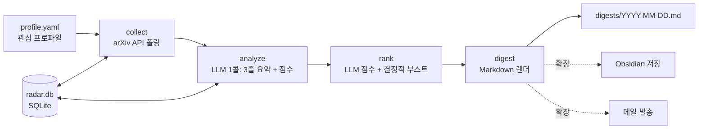

# paper-radar 설계안

> 상태: **설계** · 2026-08-20 작성 · README의 "다음 단계"를 구체화한 문서

## 1. 목표 / 비목표

**목표 (MVP)**
- 매일 아침, 내 관심사 기준으로 랭킹된 신규 arXiv 논문 다이제스트 1개(Markdown)를 자동 생성
- 논문당 한국어 3줄 요약 + 관련도 점수(근거 포함)
- 유지보수 부담 최소화: 설정 파일 하나(`profile.yaml`) + 명령 하나(`run`)

**비목표 (MVP에서 제외)**
- 웹 UI, 다중 사용자, PDF 본문 분석(초록만 사용), 저널 크롤링(확장 단계)

## 2. 아키텍처



핵심 설계 결정 4가지:

1. **요약과 점수를 LLM 1콜로 통합** — 논문당 한 번의 structured output 호출로 `{요약 3줄, 점수 0~10, 근거 1줄}`을 동시에 받는다. 호출을 분리하는 것 대비 비용·지연 절반.
2. **결정적 부스트를 LLM 점수 위에 합산** — 관심 저자 매치(+3), 제목 키워드 매치(가중치별) 등은 코드로 확정 가산. 랭킹이 순수 LLM 판단에만 의존하지 않게 한다.
3. **SQLite 하나로 상태 관리** — 표준 라이브러리 `sqlite3`, 파일 하나(`radar.db`). 중복 수집 방지(seen ID)와 분석 캐시(재실행 시 API 재호출 없음)를 겸한다.
4. **LLM 레이어는 provider 추상화** — `Claude API`(기본)와 `Ollama`(로컬)를 같은 인터페이스로. 설정에서 교체 가능.

## 3. 단계별 설계

### 3.1 수집 (collect)
- arXiv API 사용, `arxiv` pip 패키지 권장(요청 간격·페이징을 알아서 처리; arXiv 예절: 요청당 3초 간격).
- 쿼리: 프로파일의 카테고리를 OR로 결합(`cat:cond-mat.str-el OR cat:cond-mat.supr-con`), `lastUpdatedDate` 최근 2일 창으로 조회 → SQLite의 seen ID로 dedupe. 하루 실행을 건너뛰어도 다음 실행에서 복구된다.
- 참고: arXiv 신규 발표는 일~목 20:00 ET = **한국시간 화~토 오전 9~10시**. 매일 10:30 KST 실행이면 연중 안전. 일·월 아침에는 신규 발표 없음(다이제스트에 표기).
- 산출: 정규화된 `Paper` 레코드 (arxiv_id, title, authors, abstract, categories, published, updated, link).

### 3.2 분석 (analyze = 요약 + 점수)
- 입력: 프로파일의 자유 서술(`interest`) + 논문 제목/초록.
- 출력(structured output, JSON 강제): `{"summary": [3줄], "score": 0~10, "reason": "1줄"}`. Python SDK의 `client.messages.parse()` + pydantic 모델 사용.
- 캐시 키: `(arxiv_id, profile_hash)` — 프로파일이 바뀌면 재분석, 아니면 캐시 반환.
- 배치 옵션: 데일리 다이제스트는 지연에 둔감하므로 Message Batches API(비용 50% 할인)가 잘 맞는다. MVP는 동기 호출로 단순하게 시작, M4에서 전환 검토.

### 3.3 랭킹 (rank)
- `final_score = llm_score + author_boost + keyword_boost` (상한 캡).
- 정렬 후 `top_n`은 상세 블록, `min_score` 미만은 접힌 한 줄 목록으로.

### 3.4 다이제스트 (digest)
- `digests/YYYY-MM-DD.md` 생성:
  - 헤더: 날짜, 수집 N편 / 상세 표시 M편
  - 논문별: 제목(링크), 저자, 점수와 근거, 3줄 요약
  - 하단: 나머지 논문 한 줄 목록 (제목 + 점수)
- 확장: 같은 렌더 결과를 Obsidian vault 경로에 복사 저장, 메일(SMTP) 발송.

## 4. 관심 프로파일 (`profile.yaml`) — README 다음 단계 1번

```yaml
categories:
  - cond-mat.str-el
  - cond-mat.supr-con
keywords:                # 제목/초록 매치 시 가산점
  - term: superconductivity
    weight: 2
  - term: kagome
    weight: 3
authors: []              # 매치 시 강제 상위 노출 (+3)
interest: >              # LLM 관련도 판단에 그대로 전달되는 자유 서술 (핵심 설정)
  예: 강상관 전자계와 비관례적 초전도의 페어링 메커니즘,
  플랫밴드/카고메 격자 물질에 관심. 순수 ML 방법론 논문은 관심 낮음.
llm:
  provider: claude       # claude | ollama
  model: claude-opus-5   # ollama 예: qwen3:14b
  language: ko           # 요약 언어
digest:
  top_n: 10
  min_score: 4
  output_dir: digests/
  obsidian_path: null    # 확장: 설정 시 Obsidian에도 저장
```

- 실제 `profile.yaml`은 개인 설정이므로 `profile.example.yaml`만 커밋하고 본 파일은 gitignore(선택).
- API 키는 `ANTHROPIC_API_KEY` 환경변수로만, 파일에 두지 않는다.

## 5. LLM 레이어와 비용

```python
class LLMClient(Protocol):
    def analyze(self, paper: Paper, profile: Profile) -> Analysis: ...
# 구현: ClaudeClient(anthropic SDK), OllamaClient(로컬 HTTP)
```

비용 추정 (하루 100편, 편당 입력 ~700 / 출력 ~200 토큰 기준):

| 구성 | 일일 | 월간 |
|---|---|---|
| claude-opus-5 ($5/$25 per MTok) | ~$0.85 | ~$26 |
| claude-opus-5 + Batches(50%) | ~$0.43 | ~$13 |
| claude-haiku-4-5 ($1/$5) | ~$0.17 | ~$5 |
| Ollama (로컬) | $0 | $0 (품질은 모델 의존) |

권장: **claude-opus-5로 시작해 품질 기준선 확보** → 프롬프트가 안정되면 haiku/Batches로 비용 최적화. Ollama는 오프라인·무료 대안으로 유지.

## 6. 프로젝트 구조 (M0에서 생성)

```
paper-radar/
├── pyproject.toml            # uv 관리, Python 3.12+
├── profile.example.yaml
├── src/paper_radar/
│   ├── __main__.py           # CLI: run | collect | digest
│   ├── config.py             # profile.yaml + 환경변수 로딩
│   ├── models.py             # Paper / Analysis / Profile
│   ├── collect.py            # arXiv 수집
│   ├── llm.py                # LLMClient 추상화 + claude/ollama 구현
│   ├── rank.py               # 점수 합산·정렬
│   ├── digest.py             # Markdown 렌더
│   └── store.py              # SQLite (papers / analyses / runs)
├── digests/
└── tests/
```

의존성: `arxiv`, `anthropic`, `pyyaml`, `pydantic`. (Ollama는 표준 HTTP 호출로 충분)

## 7. 마일스톤

| 단계 | 내용 | 완료 기준 |
|---|---|---|
| **M0** 스켈레톤 | uv 프로젝트, src 레이아웃, CLI 뼈대, 프로파일 로딩 | `uv run paper-radar --help` 동작 |
| **M1** 수집 | arXiv 폴링 + SQLite dedupe | `collect` 첫 실행 시 신규 N건 저장, 즉시 재실행 시 0건 |
| **M2** 분석 | LLM 1콜 요약+점수, structured output, 캐시 | 논문 1건 → 3줄 요약+점수, 재실행 시 API 호출 0회 |
| **M3** 다이제스트 | Markdown 렌더 + E2E | `run` 1회로 `digests/날짜.md` 완성 — **README 다음 단계 2번 = MVP 달성** |
| **M4** 확장 | ~~Obsidian 저장~~, ~~메일~~, ~~cron 가이드~~ 완료(2026-08) · 남음: Batches 전환, 저널 RSS | 선택적 |

M0~M3는 각각 반나절~하루 규모. M3까지가 README의 MVP 정의와 일치한다.

## 8. 결정 사항 (2026-08 확정)

| 질문 | 결정 |
|---|---|
| LLM 1순위 | Claude API 기본, Ollama 병행 지원 (`llm.provider`) — 구현됨 |
| 실행 위치 | 로컬 cron 10:30 KST (README 사용법에 crontab 예시). GitHub Actions는 radar.db 상태 보존 문제(캐시/커밋)를 풀어야 해서 보류 |
| `digests/` 커밋 여부 | gitignore — 전달은 Obsidian 복사·메일로 |
| 카테고리·키워드 실제 값 | 위상 초전도체·마요라나 프로파일로 확정 (`profile.example.yaml`) |

남은 확장(선택): Batches 전환(지연 무관 배치라 비용 50% 절감 — run 을 제출/수거 2단계로 나누는 복잡도와 교환), 저널 RSS 소스 추가.
